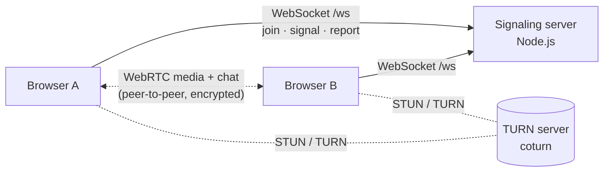

# Meet Strangers

Anonymous, signup-free, one-to-one **video and voice chat with random strangers**, in the spirit of
Omegle, built with a security-first and privacy-first design.

- **No accounts.** Open the page, confirm you are 18+, and start talking. Each visit is a fresh,
  anonymous session.
- **Video or voice-only** modes, optional **interest matching**, peer-to-peer **text chat**.
- **Next / Stop / Mute / Camera off / Report**, with the classic double-<kbd>Esc</kbd> shortcut to
  skip.
- **Media never touches the server.** Audio, video and chat flow directly between the two
  browsers over encrypted WebRTC (DTLS-SRTP). The server only introduces peers to each other.

## Architecture



| Package           | Stack                                  | Responsibility                                                      |
| ----------------- | -------------------------------------- | ------------------------------------------------------------------- |
| `packages/shared` | TypeScript, Zod                        | The wire protocol: message types, runtime validation, size limits   |
| `packages/server` | Node 22, `ws`, Express 5, Helmet, Pino | Matchmaking, signaling relay, abuse protection, serving the web app |
| `packages/client` | React 19, Vite                         | UI, camera/mic handling, WebRTC peer connection, text chat          |

**Lifecycle of a chat**

1. The browser opens a WebSocket to `/ws` and sends `join { mode, interests, acceptedTerms }`.
2. The matchmaker pairs it with a waiting user of the same mode, preferring a shared interest and
   falling back to anyone after `INTEREST_MATCH_TIMEOUT_MS`. Waiting is FIFO.
3. Both users receive `matched` with a server-generated `matchId`, a fixed role (`offerer` or
   `answerer`, which rules out offer "glare"), and short-lived ICE/TURN credentials.
4. SDP offers, answers and ICE candidates are relayed as `signal { matchId, payload }`. The server
   forwards a signal **only** to the sender's current partner in that exact match.
5. Pressing **Next** sends `join` again. The server ends the chat atomically, notifies the partner
   (`partner_left`) and re-queues the user. The same pair is not re-matched during a cooldown.

## Security & privacy model

Every input from a browser is treated as hostile: the other stranger, a modified client, or a
script.

| Threat                                     | Mitigation                                                                                                                                                          |
| ------------------------------------------ | ------------------------------------------------------------------------------------------------------------------------------------------------------------------- |
| Cross-site WebSocket hijacking             | `Origin` must match `ALLOWED_ORIGINS` (or same-origin) before the handshake completes, else `403`                                                                   |
| Injecting signals into someone else's call | Clients can't address users. Signals go only to the current partner of the referenced `matchId`; stale or forged IDs are dropped                                    |
| Late signals leaking into the next chat    | Every match-scoped message carries `matchId`, checked on the server **and** the client                                                                              |
| Malformed / oversized messages             | Strict Zod schemas (unknown keys rejected), 64 KB frame limit, SDP/candidate/chat length limits, binary frames rejected; repeat offenders disconnected (`1008`)     |
| Flooding / "next" spam                     | Per-connection token buckets (messages, joins, reports), per-IP concurrent connection and connection-rate limits, global connection cap, slow-consumer cut-off      |
| IP spoofing to evade limits                | `X-Forwarded-For` is ignored unless `TRUST_PROXY_HOPS` is set, and then only the entry written by your own proxy is used. IPv6 is limited per /64                   |
| Abusive users                              | Report button (also for the stranger who just left). Reports from **distinct** reporters within a window trigger a temporary ban, and active sessions are closed    |
| Personal data                              | No accounts, cookies, chat logs or recordings. IPs are only kept in memory as an HMAC; logs never contain raw IPs, SDP, ICE candidates or chat text                 |
| TURN credential theft / TURN as open relay | Time-limited HMAC credentials (TURN REST API) per chat. The coturn config denies private/loopback peers (SSRF) and sets quotas                                      |
| XSS / clickjacking / data exfiltration     | Strict CSP (`script-src 'self'`, `frame-ancestors 'none'`, no inline scripts), chat rendered as text and never linkified, `Permissions-Policy`, `no-referrer`, HSTS |
| Dead connections                           | WebSocket heartbeats every 15 s; ICE connection timeouts and automatic move-on on the client                                                                        |
| Operational                                | Fail-fast config validation, graceful shutdown (clients are told and reconnect with jittered backoff), health/readiness probes, non-root read-only container        |

> **IP address visibility.** As with any peer-to-peer call, a stranger's browser can learn your IP
> address from ICE candidates. Set `ICE_TRANSPORT_POLICY=relay` (requires TURN) to route all media
> through your TURN server so peers only ever see the relay's address.

See [SECURITY.md](SECURITY.md) for how to report vulnerabilities and for known limitations.

## Getting started

Requirements: **Node.js ≥ 22.12** (see `.nvmrc`) and npm ≥ 10.

```bash
npm install
npm run dev
```

This starts the signaling server on `:8080` and the Vite dev server on
[http://localhost:5173](http://localhost:5173), which proxies `/ws` to the server. Open two browser
windows (or a normal and a private window) to talk to yourself. `localhost` counts as a secure
context, so camera access works without HTTPS during development.

### Scripts

| Command            | What it does                                                     |
| ------------------ | ---------------------------------------------------------------- |
| `npm run dev`      | Server (watch mode) + client dev server                          |
| `npm run build`    | Production build of client and server                            |
| `npm start`        | Run the built server (also serves the built client)              |
| `npm test`         | Unit and integration tests for all packages (Vitest)             |
| `npm run test:e2e` | End-to-end: two real Chromium browsers with fake cameras connect |
| `npm run check`    | Format check, lint, typecheck, and tests, as run in CI           |

## Configuration

All configuration comes from environment variables, validated at startup. See
[`.env.example`](.env.example) for the full annotated list. The most important ones:

| Variable               | Default   | Notes                                                                       |
| ---------------------- | --------- | --------------------------------------------------------------------------- |
| `ALLOWED_ORIGINS`      | _(empty)_ | e.g. `https://meet.example.com`. Empty = same-origin only                   |
| `TRUST_PROXY_HOPS`     | `0`       | Number of reverse proxies in front of the app. **Must match reality**       |
| `TURN_URLS`            | _(empty)_ | coturn URLs. Without TURN, users behind strict NATs/firewalls can't connect |
| `TURN_SECRET`          | _(empty)_ | coturn `static-auth-secret` (`openssl rand -hex 32`)                        |
| `ICE_TRANSPORT_POLICY` | `all`     | `relay` hides users' IPs from each other (requires TURN)                    |
| `IP_HASH_SECRET`       | random    | Set it to keep bans across restarts                                         |
| `REPORT_BAN_THRESHOLD` | `3`       | Distinct reporters within `REPORT_WINDOW_MS` before a `BAN_DURATION_MS` ban |

## Deployment

```bash
cp .env.example .env    # fill in ALLOWED_ORIGINS, TURN_*, TRUST_PROXY_HOPS
docker compose up -d --build
```

The compose file runs the app (non-root, read-only filesystem, all capabilities dropped) and a
hardened coturn server. You also need:

1. **HTTPS.** Browsers only allow camera and microphone access in a secure context. Terminate TLS
   in a reverse proxy (Caddy, nginx, or a cloud load balancer) that forwards WebSocket upgrades for
   `/ws`, and set `TRUST_PROXY_HOPS` to the number of proxies.
2. **A TURN server** reachable on UDP/TCP 3478, TLS 5349 and the relay port range in
   `deploy/turnserver.conf`, with `TURN_EXTERNAL_IP` set to its public IP.
3. **Probes:** `GET /healthz` (liveness) and `GET /readyz` (returns `503` while draining).

### Scaling

Matchmaking state lives in process memory, so a single instance is the unit of deployment. Each
instance is lightweight because it only relays small signaling messages, never media. Load-test
with your own traffic profile before relying on a specific capacity. To run several instances, move the queue and match table to shared storage
(e.g. Redis) and route signals between instances. The matchmaker's event-based interface was
designed so the transport layer would not need to change.

## Testing

- **Shared**: protocol validation, size limits, interest normalization.
- **Server**: matchmaker state machine, token buckets, IP guard (limits, distinct-reporter bans,
  pruning), `X-Forwarded-For` parsing, origin checks, TURN credentials, configuration. Integration
  tests start a real server and drive it with WebSocket clients: cross-site handshakes, signal
  isolation between matches, disconnect handling, oversized/binary/garbage frames, rate limiting,
  reporting after the partner left, bans, and graceful shutdown.
- **Client**: the chat state machine (stale `matchId` events, rate-limited join retry, reconnects,
  bans, late matches after stop) and media error handling.
- **End-to-end**: two isolated Chromium browsers with fake camera devices are matched, exchange
  real video frames and chat messages (including an HTML-injection attempt), skip, report, and
  verify security headers.

## Known limitations

- There is **no automated content moderation** (e.g. nudity detection). Moderation relies on user
  reports and temporary bans. Bans are per IP, so users behind a shared NAT share a ban, and a
  determined abuser can change IP.
- The 18+ confirmation is self-declared, as on comparable services.
- Single-instance matchmaking (see [Scaling](#scaling)).
