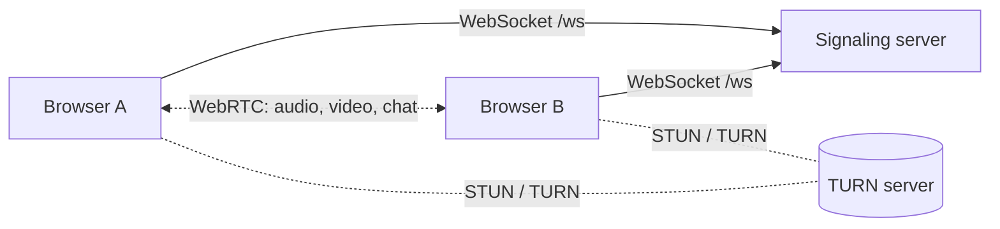

# Meet Strangers

[](https://github.com/GovardhaneNitin/meet-strangers/actions/workflows/ci.yml)

Meet Strangers is an anonymous, one-to-one video and voice chat that pairs you with a random
person. There is no sign-up and nothing to configure: open the page, confirm you are 18 or older,
and you are connected to someone new.

Calls are peer-to-peer over WebRTC. The server matches users and relays the connection handshake,
but audio, video and text chat travel directly between the two browsers, encrypted with
DTLS-SRTP. Nothing is recorded or stored.

## Features

- Video or voice-only chat, matched with people using the same mode
- Optional interests: users with a shared interest are paired first, then anyone after a short wait
- Text chat alongside the call (sent peer-to-peer over a WebRTC data channel)
- Next, stop, mute and camera controls, plus a double <kbd>Esc</kbd> shortcut to skip
- Reporting, including the person who just left, with temporary bans after reports from multiple
  users
- Responsive layout for desktop and mobile

## Tech stack

| Area      | Technology                                         |
| --------- | -------------------------------------------------- |
| Client    | React 19, TypeScript, Vite                         |
| Server    | Node.js, TypeScript, `ws`, Express 5, Helmet, Pino |
| Protocol  | Shared TypeScript package with Zod validation      |
| Media     | WebRTC, STUN, TURN (coturn)                        |
| Testing   | Vitest, Playwright                                 |
| Packaging | npm workspaces, Docker, Docker Compose             |

## How it works



1. The client opens a WebSocket to `/ws` and sends a `join` message with its mode and interests.
2. The matchmaker pairs it with the longest-waiting compatible user. Users with interests are held
   for a shared-interest match for up to `INTEREST_MATCH_TIMEOUT_MS` before anyone is accepted.
3. Both clients receive a `matched` message with a server-generated `matchId`, a fixed role
   (offerer or answerer), and short-lived TURN credentials. Fixed roles avoid both sides sending
   an offer at the same time.
4. SDP offers, answers and ICE candidates are relayed as `signal` messages. The server only
   forwards a signal to the sender's partner in that exact match, so a client can never reach
   anyone else's call, and late messages from a previous chat are dropped.
5. Skipping sends `join` again. The server ends the chat, notifies the other person and re-queues
   the user. The same two people are not re-matched for `REMATCH_COOLDOWN_MS`.

## Getting started

Prerequisites: Node.js 22.12 or newer (see `.nvmrc`) and npm 10 or newer.

```bash
git clone https://github.com/GovardhaneNitin/meet-strangers.git
cd meet-strangers
npm install
npm run dev
```

This starts the signaling server on port 8080 and the client on
[http://localhost:5173](http://localhost:5173). The Vite dev server proxies `/ws` to the backend.
To try a call locally, open the app in two separate windows (for example a normal and a private
window). Browsers treat `localhost` as a secure context, so camera access works without HTTPS in
development.

### Scripts

| Command            | Description                                                     |
| ------------------ | --------------------------------------------------------------- |
| `npm run dev`      | Run the server in watch mode and the client dev server          |
| `npm run build`    | Build the client and the server for production                  |
| `npm start`        | Start the built server, which also serves the built client      |
| `npm test`         | Run unit and integration tests in all packages                  |
| `npm run test:e2e` | Run end-to-end tests in Chromium and Firefox with fake media    |
| `npm run check`    | Formatting, lint, type checks and tests (the same checks as CI) |

## Project structure

```
packages/
  shared/   Wire protocol: message schemas, size limits, interest normalization
  server/   Signaling server: matchmaking, message relay, rate limiting, static hosting
  client/   React application: UI, media devices, WebRTC connection, text chat
e2e/        Playwright end-to-end tests
deploy/     coturn configuration
```

## Configuration

The server reads its configuration from environment variables and validates them at startup; an
invalid value stops the process with a clear error. [`.env.example`](.env.example) documents every
option. The ones most deployments need:

| Variable               | Default   | Description                                                              |
| ---------------------- | --------- | ------------------------------------------------------------------------ |
| `ALLOWED_ORIGINS`      | _(empty)_ | Origins allowed to open the WebSocket. Empty means same-origin only      |
| `TRUST_PROXY_HOPS`     | `0`       | Number of reverse proxies in front of the server                         |
| `TURN_URLS`            | _(empty)_ | TURN server URLs. Needed for users behind strict NATs or firewalls       |
| `TURN_SECRET`          | _(empty)_ | Shared secret for coturn's `static-auth-secret`                          |
| `ICE_TRANSPORT_POLICY` | `all`     | Set to `relay` to send all media through TURN and hide users' IPs        |
| `REPORT_BAN_THRESHOLD` | `3`       | Reports from distinct users within `REPORT_WINDOW_MS` that trigger a ban |

## Deployment

The Compose stack is a complete single-server deployment: Caddy for HTTPS, the application, and
a coturn TURN server.

1. Point your domain's DNS record at the server and open ports 80 and 443 (TCP), 443 (UDP),
   3478 and 5349 (TCP and UDP), and the TURN relay port range from `deploy/turnserver.conf`.
2. Configure and start the stack:

   ```bash
   cp .env.example .env    # set DOMAIN, TURN_URLS, TURN_SECRET, TURN_REALM and TURN_EXTERNAL_IP
   docker compose up -d --build
   ```

Caddy obtains and renews a Let's Encrypt certificate for `DOMAIN` automatically and proxies
WebSocket traffic to the app. Compose derives `ALLOWED_ORIGINS` (`https://$DOMAIN`) and
`TRUST_PROXY_HOPS` (`1`) from this setup. The app runs as a non-root user on a read-only
filesystem.

To use your own reverse proxy or load balancer instead, remove the `caddy` service, forward
WebSocket upgrades on `/ws` to port 8080, and set `ALLOWED_ORIGINS` and `TRUST_PROXY_HOPS` to
match your setup. `GET /healthz` reports liveness, and `GET /readyz` returns `503` while the server
drains connections during shutdown.

Matchmaking state is held in memory, so the server runs as a single instance. Running several
instances would require moving the queue and active matches into shared storage such as Redis and
routing signaling messages between instances.

## Security

Every message from a client is treated as untrusted. The main protections are:

- **Message validation:** strict schemas that reject unknown fields, size limits on every field,
  and a 64 KB frame limit. Clients that keep sending invalid data are disconnected.
- **Cross-site protection:** WebSocket connections are only accepted from allowed origins.
- **Call isolation:** a client can only send signals to its current partner, identified by a
  server-issued `matchId`.
- **Rate limiting:** limits per connection (messages, skips, reports) and per IP address
  (concurrent connections and connection rate). IPv6 addresses are grouped by /64.
- **Proxy handling:** `X-Forwarded-For` is only trusted for the configured number of proxies, so
  clients cannot spoof their address to evade limits or bans.
- **Privacy:** no accounts, cookies, logs of chat content or recordings. IP addresses are only
  kept in memory as keyed hashes and never written to logs.
- **TURN:** credentials expire and are issued per chat. The coturn configuration blocks relaying
  to private and loopback networks.
- **Browser hardening:** a strict Content Security Policy, a `Permissions-Policy` limited to camera
  and microphone, and chat messages rendered as plain text.

With the default `ICE_TRANSPORT_POLICY=all`, a peer can learn the other user's IP address from ICE
candidates, as with any peer-to-peer call. Set `ICE_TRANSPORT_POLICY=relay` to route media
through TURN instead.

To report a vulnerability, see [SECURITY.md](SECURITY.md).

## Testing

```bash
npm test                            # unit and integration tests
npx playwright install chromium firefox   # once, before the first end-to-end run
npm run test:e2e                    # end-to-end tests
```

- **Unit tests** cover the protocol schemas, the matchmaker, rate limiting, IP handling,
  configuration and the client's chat state machine.
- **Integration tests** start a real server and connect WebSocket clients to check origin checks,
  call isolation, disconnects, malformed input, rate limits, reporting, bans and graceful shutdown.
- **End-to-end tests** run in Chromium and Firefox with fake camera devices. They connect a real
  call, exchange video and chat messages, skip, report, and check the security headers.

CI runs formatting, lint, type checks, tests, a dependency audit, the end-to-end suite and a
Docker build on every pull request.

## Limitations

- Moderation relies on user reports and temporary IP-based bans. There is no automated content
  detection, users behind a shared IP share a ban, and a determined user can change IP.
- Bans and rate-limit state are held in memory, so they are cleared when the server restarts.
- Automated end-to-end tests cover Chromium and Firefox. Safari and mobile browsers are not
  covered by automated tests.
- The age requirement is self-declared.
- Matchmaking runs on a single instance (see [Deployment](#deployment)).
